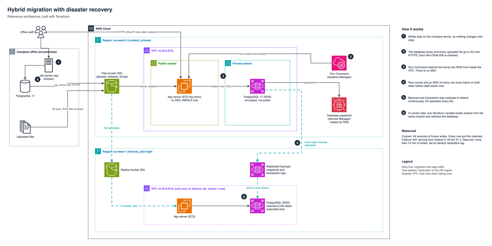

# Hybrid migration to AWS with cross-region disaster recovery

[](https://github.com/gumagatsby/aws-hybrid-migration-dr/actions/workflows/ci.yml)

A small company runs its job-tracking app, a PostgreSQL database and a folder of uploaded files on a server in the office. This project moves all of it to AWS in London, proves nothing was lost on the way, and then proves the business can survive losing the whole London region by recovering in Ireland. Every number below was measured by the scripts in this repository, not estimated.



Editable source: [`docs/architecture.drawio`](docs/architecture.drawio). Walkthrough: [`docs/walkthrough.pdf`](docs/walkthrough.pdf). Portrait version for social posts: [`docs/linkedin-architecture.drawio`](docs/linkedin-architecture.drawio).

## Measured results

| Run | Result |
|---|---|
| Migration | 501 rows and 61 files moved; every row hash and file SHA-256 matched; **94 seconds** of frozen writes |
| Failover drill | App serving from Ireland **18 min 27 s** after London went down; all migrated data recovered; **more than 10 minutes** of the drill's writes lost to backup replication lag |

Details: [`docs/migration-results.md`](docs/migration-results.md), [`docs/dr-drill-results.md`](docs/dr-drill-results.md).

## The problem it solves

| Need | How this project meets it |
|---|---|
| Get off a single office server | The app runs on EC2 and the database on Amazon RDS, which handles backups and patching |
| Move without losing or corrupting data | Writes are frozen, then every row and every file is checked by hash on both sides before cutover |
| Keep downtime short | Cutover is scripted end to end; the measured write freeze is in [`docs/migration-results.md`](docs/migration-results.md) |
| Survive losing a whole AWS region | Database backups, transaction logs and files replicate to Ireland continuously; one Terraform variable rebuilds the app there |
| Know the real recovery time and data loss | A drill script stops London and measures both; results in [`docs/dr-drill-results.md`](docs/dr-drill-results.md) |
| Keep credentials out of code | No SSH keys; the database password is generated, stored and rotated by Secrets Manager |

## What's in the repository

| Path | What it is |
|---|---|
| [`onprem/`](onprem) | The company server, simulated with Docker Compose: the app, PostgreSQL 17 and an uploads volume |
| [`app/`](app) | The job tracker (Flask). Stores files on local disk in the office and in S3 on AWS, chosen by environment |
| [`terraform/`](terraform) | London, the Ireland pilot light, S3 replication and cross-region backup replication |
| [`terraform/modules/site`](terraform/modules/site) | One complete copy of the app in a region. London creates a new database; Ireland restores from replicated backups |
| [`scripts/migrate.sh`](scripts/migrate.sh) | Freeze, dump, copy, restore, validate |
| [`scripts/dr-drill.sh`](scripts/dr-drill.sh) | Write continuously, take London down, recover in Ireland, measure RTO and RPO |

## Testing

- **App tests** (`pytest`): filename sanitising, path traversal, input validation, storage round trip.
- **Company server in CI**: GitHub Actions builds the Docker Compose stack, seeds 500 jobs, uploads a file and reads it back.
- **6 Terraform tests** (`terraform test`) against a mocked AWS provider. They check, for example, that Ireland runs nothing until failover, that backups replicate even while it is off, that the database is private and encrypted with a generated password, that the DR database restores to the latest restorable time, and that the app cannot be opened to the whole internet.
- **Checkov** scans the Terraform. Deliberate exceptions, each with its reason, are in [`.checkov.yml`](.checkov.yml).

```bash
pytest -q app/tests
cd terraform && terraform init -backend=false && terraform test
```

## Running it

```bash
# 1. The company server
docker compose -f onprem/docker-compose.yml up -d --build --wait
docker compose -f onprem/docker-compose.yml exec -T app python seed.py

# 2. AWS London (state bucket and region passed at init)
cd terraform
terraform init -backend-config="bucket=<state bucket>" -backend-config="region=eu-west-2"
terraform apply -var allowed_cidr="$(curl -s https://checkip.amazonaws.com)/32"
cd ..

# 3. Migrate, then rehearse a disaster
./scripts/migrate.sh
./scripts/dr-drill.sh

# 4. Tear down
terraform -chdir=terraform destroy -var dr_active=true
```

See [docs/decisions.md](docs/decisions.md) for the reasoning behind each choice and [docs/runbook.md](docs/runbook.md) for operating it.

## Cost

Free-tier-eligible sizes throughout (`t4g.micro`, `db.t4g.micro`), no NAT gateway, VPN or load balancer, and everything is destroyed after the run. The actual spend for the run is recorded below once billing data is available.
